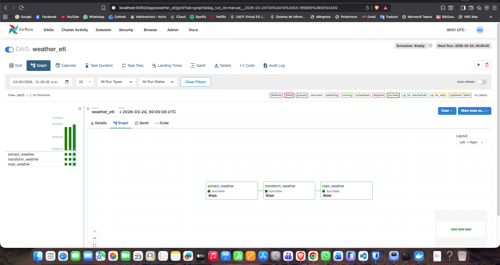
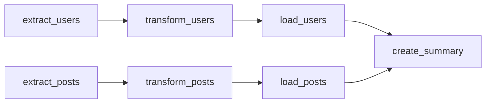
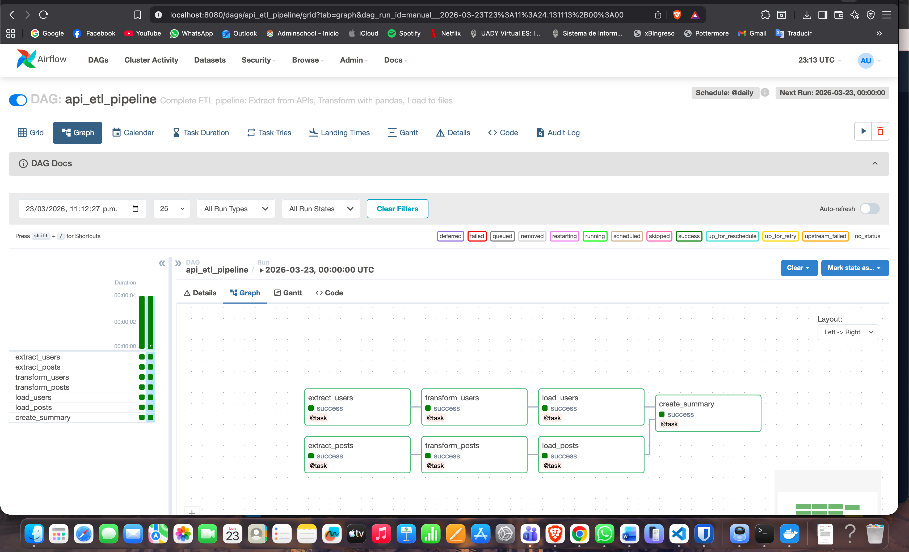
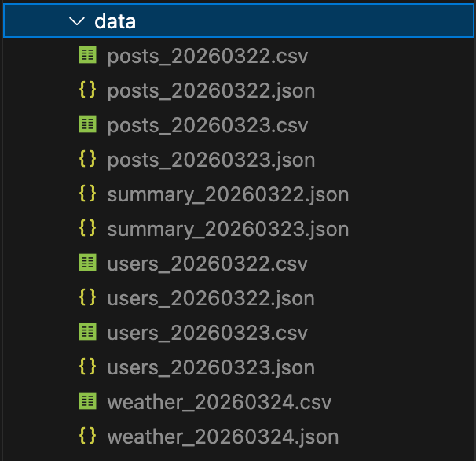

# Airflow orchestration

`dags/weather_etl.py` is a daily weather pipeline. I also ran a second workflow that pulls two APIs at the same time. The weather DAG is the code in this folder. The parallel run is documented here with its graph, its output files, and the summary it wrote.

## What the weather job does every day

`weather_etl` is scheduled `@daily` for Berlin (`52.52`, `13.41`) through [Open-Meteo](https://open-meteo.com/). The coordinates are constants so the location is obvious and easy to change. Open-Meteo does not need a key for this request.

`catchup` is off and `start_date` is 1 January 2024. If the DAG stays paused for a week, turning it on runs the next interval. It does not backfill every day since 2024. For a forecast snapshot, those missed days are stale the moment they were skipped.

1. **Extract** requests current conditions and one day of hourly temperature, apparent temperature, and humidity. The task returns the JSON. The next task receives it as an argument, and Airflow stores that handoff in XCom. The tasks do not share a file.
2. **Transform** builds an hourly frame in pandas. It converts Celsius to Fahrenheit, labels temperature (`cold`, `cool`, `warm`, `hot`) and wind (`calm`, `breezy`, `windy`, `very_windy`), and computes the daily average, minimum, maximum, and the hottest hour. Those labels are the fields a later filter would use. The raw weather code is not.
3. **Load** writes `weather_YYYYMMDD.csv` and `weather_YYYYMMDD.json` under `/opt/airflow/data`. The CSV is one row, the daily record. The JSON keeps that record plus the summary stats. The date in the filename is the run date, so a new day does not overwrite yesterday.

`samples/weather_20260324.csv` is one of those runs: 8.0 °C, category `cold`, wind `calm`, hottest hour at 16:00 with 16.1 °C.

## Why the other workflow runs in parallel

The second DAG reads users and posts from JSONPlaceholder. A user record does not need a post record to be fetched, and the other way around is the same, so `extract_users` and `extract_posts` start together. Pandas flattens users into email domains and cities, bins posts by length, and each branch writes CSV and JSON. `create_summary` waits for both loads because it reads those files. Starting the summary any earlier would summarize a file that is not there yet.

The 2026-03-22 summary, in `samples/api_etl_summary_20260322.json`, recorded 10 users, 100 posts, an average length of 160.64 characters, 91 medium posts, and 9 long posts.

## Run

Copy `dags/weather_etl.py` into the DAGs folder of a local Airflow 2.8+ environment with `pandas` and `requests` installed. The load task writes to `/opt/airflow/data`, which matches a volume mounted at `./data:/opt/airflow/data`.

Unpause `weather_etl` and trigger it. Dependencies are in `requirements.txt`.
