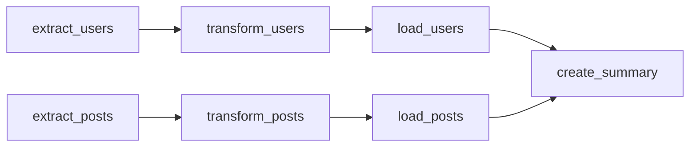

# Airflow orchestration

A daily weather pipeline written with the Airflow TaskFlow API, and notes from a second DAG that extracts two APIs in parallel.

## Weather DAG

`dags/weather_etl.py` defines `weather_etl`. It runs once a day, with catchup off, for Berlin (`52.52`, `13.41`) using [Open-Meteo](https://open-meteo.com/). No API key is required.

1. **Extract.** Current conditions and one day of hourly temperature, apparent temperature, and humidity.
2. **Transform.** Pandas builds the hourly frame. The task converts Celsius to Fahrenheit, labels temperature and wind, and computes the daily average, minimum, maximum, and the hottest hour.
3. **Load.** One CSV and one JSON land in `/opt/airflow/data`, named with the run date.

`samples/weather_20260324.csv` is a successful run: 8.0 °C, category `cold`, wind `calm`, hottest hour at 16:00 with 16.1 °C.

## Parallel API workflow

A second DAG reads JSONPlaceholder. `extract_users` and `extract_posts` have no dependency on each other, so they run in parallel. Pandas then flattens users, derives email domains and cities, bins posts by length, and writes CSV and JSON. A final task reads those files and writes `summary_YYYYMMDD.json`.

Returned values move between tasks through XCom.

On the 2026-03-22 run the summary recorded 10 users, 100 posts, an average post length of 160.64 characters, 91 medium posts, and 9 long posts. That file is `samples/api_etl_summary_20260322.json`.

## Run

Put `dags/weather_etl.py` in the Airflow DAGs folder of a local Airflow 2.8+ environment that has `pandas` and `requests`. The load task expects `/opt/airflow/data` to be writable, which matches a Compose volume mounted at `./data:/opt/airflow/data`.

Unpause `weather_etl` in the UI and trigger it. Dependencies are listed in `requirements.txt`.
